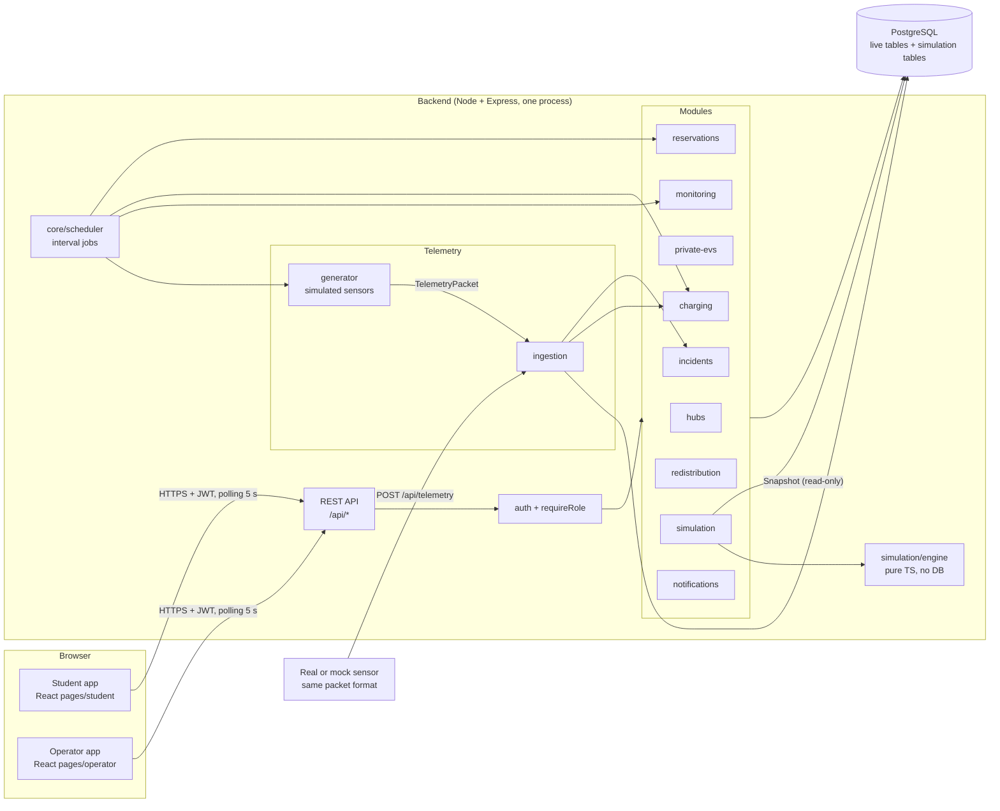
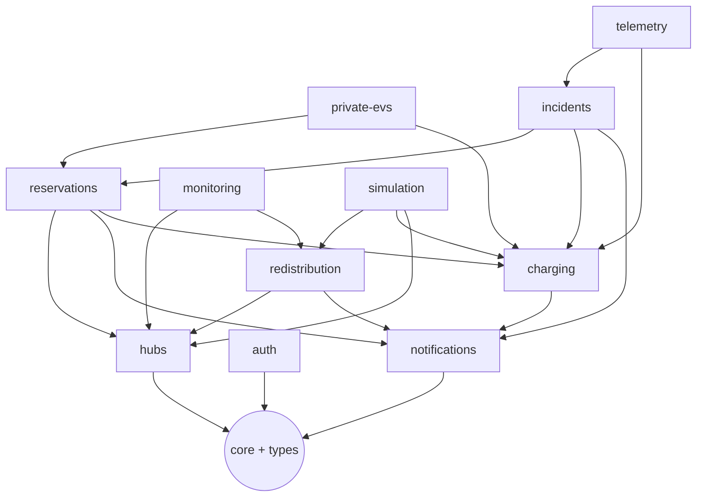

# ARCHITECTURE.md — Smart E-Mobility Hub (Group 10, HK261)

> How the system is built. **What** it must do is in `docs/SPEC.md`; **endpoint details** are in `docs/CONTRACTS.md`.
> Decision IDs (`D-xx`) are defined in SPEC.md §8; §16 here explains the trade-offs (report Section 3.1).
> Owner of this file: **M1**. Other members propose changes by PR.

---

## 1. Overview

**Style: modular monolith.** One Express backend process holds every module, the background jobs, the simulated sensor feed and the simulation engine. One Postgres database holds all state. One React app serves both students and operators (role-based routes).



**System boundary (report 2.1.3):** the generator is *inside* the backend but plays the external sensor. It hands packets to the same `ingest()` function that `POST /api/telemetry` uses, so a real sensor or `scripts/mock-sensor.ts` can replace it with zero code changes (NFR-24).

---

## 2. Runtime view

| Process | Where | Notes |
|---|---|---|
| Backend (API + jobs + generator) | Render web service (Docker) | **Exactly one instance** (D-02). Jobs start in `server.ts` when `JOBS_ENABLED=true`. |
| PostgreSQL | Render Postgres (prod), `docker-compose.yml` (dev, test) | Needs the `btree_gist` extension (exclusion constraints, §5.2). |
| Frontend | Vercel (static SPA) | Talks to the backend via `VITE_API_URL`. |

**Background jobs** (`core/scheduler.ts`, each job wrapped in try/catch + log, never crashes the process):

| Job | Every | Does | FR/BR |
|---|---|---|---|
| `telemetry.generate` | 5 s | Builds one packet per Hub (skips "stalled" Hubs) and calls `ingest()` | FR-30, D-17 |
| `reservations.tick` | 5 s | Expire due vehicle/parking Reservations; start/finish parking windows | BR-03, FR-18 |
| `charging.schedule` | 5 s + on event | Start advance slots that are due; assign free points to the queue | FR-49, BR-06 |
| `monitoring.evaluate` | 5 s + on event | Capacity, low-battery, fault, imbalance alerts; stalled-feed check | FR-33, FR-35, FR-43 |

Jobs read everything they need from Postgres on every run, so a restart loses nothing (NFR-27). Events (§4.6) only make them run sooner.

---

## 3. Backend structure and module rules (NFR-15)

```
backend/src/
  server.ts          starts HTTP server + jobs
  app.ts             express(), json, cors, routes, error handler
  core/              shared code — only M1 edits
  types/enums.ts     every state and vocabulary value
  telemetry/         generator, ingestion, routes
  modules/<name>/    <name>.routes.ts (HTTP only) + <name>.service.ts (logic + DB)
```

**Layering inside a module**
- `*.routes.ts`: parse + validate input, call the service, send the response. No Prisma calls, no business rules.
- `*.service.ts`: business rules, transactions, Prisma. Exports plain async functions. Each function that writes takes an optional `tx` so other modules can include it in their transaction.
- Pure helpers (no DB, no Express) go in their own file, e.g. `charging/priority.ts`, `charging/schedule.ts`, `simulation/engine.ts`. These are the easiest to unit-test.

**Who may import whom** (arrow = "may call the service of"). No cycles: CI runs `madge --circular backend/src`.



Rules
1. A module imports another module's `*.service.ts` (or a pure helper file it exports). Never its routes, never its Prisma calls.
2. Every module may import `core/*` and `types/*`. `core` imports no module.
3. `simulation/engine.ts` imports **no** Prisma, no `core/db.ts` (lint rule `no-restricted-imports`). It may import the pure files `charging/priority.ts` and `charging/schedule.ts`.
4. If two modules need each other, move the shared part into the lower one or into a pure helper. Ask M1.
5. Charging never imports reservations (D-23); it reads vehicle_reservation read-only for D-13.

---

## 4. Cross-cutting conventions (`core/`)

### 4.1 Database access and transactions (`core/db.ts`)

```ts
export const db = new PrismaClient();
export type Tx = Prisma.TransactionClient;

type LockableTable = 'rental_vehicle' | 'parking_space' | 'charging_point'
  | 'vehicle_reservation' | 'parking_reservation' | 'charging_request'
  | 'redistribution_task' | 'incident' | 'private_ev';

/** SELECT … FOR UPDATE on one row. Throws NotFound if missing. Table name is a fixed union, never user input. */
export async function lockRow(tx: Tx, table: LockableTable, id: string): Promise<void>;
```

- Every write that checks-then-changes state runs in `db.$transaction(async (tx) => …)`.
- **Lock order** (prevents deadlocks): vehicle rows (private_ev / rental_vehicle) → parking_space → charging_point → booking rows (vehicle_reservation / parking_reservation → charging_request). Jobs follow the same order.
- Picking "any free resource" uses `FOR UPDATE SKIP LOCKED LIMIT 1` via `$queryRaw`, so two concurrent requests take different resources or the loser finds none (BR-10).
- DB constraints (§5.2) are the last guard. `core/errors.ts` maps Postgres `23505` (Prisma `P2002`) and `23P01` (exclusion violation) to `409 RESOURCE_TAKEN` unless the caller maps them to something more specific.

### 4.2 State transitions (`core/stateMachine.ts`, BR-05)

```ts
export const transitions = {
  rentalVehicle: { AVAILABLE: ['RESERVED','IN_TRANSIT','FAULTY'], RESERVED: ['AVAILABLE','IN_USE','FAULTY'], … },
  …
} as const;
export function assertTransition(entity: Entity, from: string, to: string): void; // pure: throws InvalidStateTransitionError (409)
```
Services call `assertTransition` before every status update (including the system tables in SPEC §4: alert, simulation run, recommendation). `stateMachine.test.ts` checks every row of SPEC §4 and a sample of forbidden moves.

**Audit of invalid attempts (D-22):** `assertTransition` writes nothing — it usually runs inside a transaction that the throw rolls back. `errorHandler` in `core/errors.ts` sees the `InvalidStateTransitionError` and writes the `INVALID_TRANSITION` audit row with plain `db`, after the rollback. `requireRole` writes `SECURITY_DENIED` the same way.

### 4.3 Validation

No Zod. `core/errors.ts` exports small helpers used by routes: `requireString`, `requireInt(min,max)`, `requireNumber`, `requireEnum`, `requireIsoDate`, `optional(...)`. Each throws `AppError(400, 'VALIDATION_ERROR', message, { field })`. Every invalid input → 400 with **0 state changes** (NFR-13).

### 4.4 Error format (NFR-05)

Every error response has this shape; the frontend `ErrorBox` renders `message`, `nextActions` and `alternatives`.

```json
{
  "error": {
    "code": "RESOURCE_TAKEN",
    "message": "This vehicle was just reserved by someone else.",
    "nextActions": ["Pick another vehicle at Metro Station Hub", "Search other Hubs"],
    "alternatives": [{ "type": "rentalVehicle", "id": "RV-0112", "hubId": "metro", "batteryPct": 74 }],
    "details": {}
  }
}
```

| HTTP | When | Example codes |
|---|---|---|
| 400 | Bad input | `VALIDATION_ERROR` |
| 401 | No / bad token | `UNAUTHENTICATED` |
| 403 | Wrong role or not owner | `FORBIDDEN` |
| 404 | Unknown id (or not yours) | `NOT_FOUND` |
| 409 | Business rule / state / race | `RESOURCE_TAKEN`, `ACTIVE_RENTAL_EXISTS`, `HUB_FULL`, `INVALID_STATE_TRANSITION`, `HOLD_EXPIRED`, `LOW_BATTERY`, `CLASS_MISMATCH`, `CAPACITY_EXCEEDED`, `SESSION_PROTECTED` |

A user asking for another user's record gets 404 (doesn't reveal it exists).

### 4.5 Auth (`core/auth.ts`, D-15, FR-29/60/61)

- `POST /api/auth/register` creates `STUDENT` only. A body containing `role: "OPERATOR"` → 403.
- `POST /api/auth/login` → `{ token, user }`. JWT HS256, payload `{ sub, role }`, expiry `JWT_EXPIRES_IN` (8 h).
- `requireAuth` reads `Authorization: Bearer …`, sets `req.user`. `requireRole('OPERATOR')` → 403 + audit row `SECURITY_DENIED`.
- Passwords: `bcrypt` cost 10. Operators come only from `seed.ts`.

### 4.6 Audit, notifications, events

- `audit(tx, { actorId, action, entityType, entityIds, reason?, details? })` — appends to `audit_log` **inside the same transaction** as the change (if the audit insert fails, the whole action fails — UC-20 E1). Called for every Operator state change (FR-63) and for denied/invalid attempts.
- `notify(tx, { userId, type, title, body, data })` — inserts a `notification` row inside the transaction (FR-62). Delivery = the bell polls `GET /api/notifications` every 5 s; unread rows survive offline time (UC-18 E1).
- `events` (`core/events.ts`) — a typed Node `EventEmitter`. Emit **only after** `$transaction` resolves. Listeners do side effects that are safe to lose, because the interval jobs repeat them anyway.

| Event | Emitted by | Listeners |
|---|---|---|
| `TELEMETRY_INGESTED {hubId}` | ingestion | monitoring.evaluateHub |
| `CHARGING_QUEUE_CHANGED {hubId}` | charging, incidents, private-evs | charging.runScheduler(hubId) |
| `RESOURCE_WITHDRAWN {hubId}` | incidents | monitoring.evaluateHub, charging.runScheduler |
| `RESERVATION_CHANGED {hubId}` | reservations | monitoring.evaluateHub |

---

## 5. Data model

Prisma models use PascalCase and `@@map("snake_case")`; **fields are not `@map`ped**, so columns are camelCase (raw SQL quotes them: `"userId"`). All ids are `String` (readable seed ids like `RV-0001`, `MET-CP-M-03`; `cuid()` for created rows), except `audit_log.id` (bigserial). All times are `DateTime @db.Timestamptz`. Battery fields are `Float` 0–100. Every state and vocabulary column is a **Prisma enum** = Postgres enum type, values exactly as CONTRACTS §1 (D-21); `types/enums.ts` mirrors them for code and the frontend.

### 5.1 Tables

**Accounts and Hubs**

| Table | Key fields |
|---|---|
| `user` | id, identifier (unique), passwordHash, displayName, role `STUDENT\|OPERATOR`, mustChangePassword, createdAt |
| `hub` | id (`metro`, `dorm`, `campus-a`, `campus-b`, `service`), name, location, lastTelemetryAt?, createdAt |
| `hub_threshold` | hubId, vehicleClass, minAvailable, maxAvailable (unique hubId+class) — BR-15 |
| `hub_redirect` | id, fromHubId, toHubId, activeUntil, createdById, recommendationId? — applied REDIRECT recommendations (D-12) |
| `setting` | key (PK), value Json — e.g. `charging.weights` (FR-48) |

**Resources**

| Table | Key fields |
|---|---|
| `rental_vehicle` | id, hubId, type `E_BICYCLE\|E_MOTORCYCLE`, vehicleClass (always `MOTORCYCLE`), status, batteryPct, parkingSpaceId? (unique — the FLEET space it occupies, D-14), updatedAt |
| `private_ev` | id, ownerId, type `E_MOTORCYCLE\|CAR`, vehicleClass, label, batteryCapacityKwh, batteryPct, deletedAt? (soft delete, FR-27) |
| `parking_space` | id, hubId, vehicleClass, pool `FLEET\|PUBLIC` (D-16), status `FREE\|RESERVED\|OCCUPIED\|UNAVAILABLE`, reservedForTaskId? (redistribution, D-19) |
| `charging_point` | id, hubId, vehicleClass, status `AVAILABLE\|CHARGING\|FAULTY` — the current session is the `charging_request` with this `chargingPointId` and status `CHARGING` (derived, D-04) |

**Bookings**

| Table | Key fields |
|---|---|
| `vehicle_reservation` (= rental record) | id, userId, rentalVehicleId, hubId (pick-up), status, createdAt, expiresAt, pickedUpAt?, returnedAt?, returnHubId?, startBatteryPct?, endBatteryPct?, endReason? (`RETURNED\|CANCELLED\|EXPIRED\|INCIDENT`), idempotencyKey? |
| `parking_reservation` | id, userId, parkingSpaceId, hubId, vehicleClass, privateEvId?, windowStart, windowEnd, status, claimedAt?, expiresAt (= min(windowStart + hold, windowEnd)), bookingGroupId?, idempotencyKey?, createdAt |
| `charging_request` | id, requestedById, ownerId? (null for fleet dispatch), vehicleKind `RENTAL\|PRIVATE`, rentalVehicleId?, privateEvId?, vehicleClass, hubId, mode `QUEUE\|ADVANCE`, status, targetPct, startPct, currentPct, desiredTime, neededBy? (upcoming usage, BR-06), chargingPointId?, slotStart?, slotEnd?, startedAt?, endedAt?, endReason? (`TARGET_REACHED\|USER_STOP\|POINT_FAILURE\|VEHICLE_FAULT`), finalPct?, manualAdjust (default 0), bookingGroupId?, createdAt |
| `idempotency_key` | key + userId (PK), endpoint, responseStatus, responseBody Json, createdAt — NFR-08 |

**Operations**

| Table | Key fields |
|---|---|
| `incident` | id, resourceType `RENTAL_VEHICLE\|PARKING_SPACE\|CHARGING_POINT`, resourceId, hubId, vehicleClass, category, notes, source `OPERATOR\|STUDENT\|TELEMETRY`, reportedById?, status, resolutionNotes?, createdAt, inMaintenanceAt?, resolvedAt? |
| `incident_report` | id, incidentId, source, reportedById?, notes, createdAt — extra reports linked to an open incident (UC-21 E2) |
| `incident_impact` | id, incidentId, bookingType `VEHICLE_RESERVATION\|PARKING_RESERVATION\|CHARGING_REQUEST`, bookingId, userId?, outcome `REASSIGNED\|CANCELLED\|ENDED`, newResourceId? — FR-39/40 |
| `alert` | id, type `NEAR_CAPACITY\|LOW_BATTERY\|FAULT\|STALLED_FEED\|SHORTAGE\|SURPLUS`, hubId, vehicleClass?, resourceIds String[], metric Json, message, status `OPEN\|ACKNOWLEDGED\|DISMISSED\|RESOLVED`, dedupeKey, createdAt, lastSeenAt, closedAt?, closedById? |
| `redistribution_task` | id, sourceHubId, destHubId, vehicleClass, vehicleType?, count, status, override, reason?, origin `MANUAL\|SIMULATION`, recommendationId?, createdById, createdAt, approvedAt?, startedAt?, completedAt?, failedAt?, cancelledAt?, updatedAt |
| `redistribution_task_vehicle` | taskId, rentalVehicleId (PK both) |
| `notification` | id, userId, type, title, body, data Json, readAt?, createdAt |
| `audit_log` | id (bigserial), at, actorId?, actorRole?, action, entityType, entityIds String[], reason?, details Json — append-only |
| `telemetry_reject` | id, hubId?, packetTimestamp?, reason, payload Json, receivedAt — NFR-25 |

**Simulation (never live data)**

| Table | Key fields |
|---|---|
| `sim_scenario` | id, name, conditions Json (list of templates + params), horizonH, seed, createdById, createdAt |
| `sim_run` | id, scenarioId, status `RUNNING\|COMPLETED\|FAILED\|INCOMPLETE`, snapshot Json, results Json, startedAt, finishedAt?, durationMs?, savedName? (FR-59) |
| `sim_recommendation` | id, runId, type `REDISTRIBUTE\|CHARGING_ADJUST\|REDIRECT`, payload Json, projectedImpact Json, status `PENDING\|APPLIED\|DISMISSED\|BLOCKED`, confirmToken?, confirmTokenExpiresAt?, appliedById?, appliedAt? |

### 5.2 Constraints Prisma can't express (raw-SQL migration, D-03)

Create with `npx prisma migrate dev --create-only --name constraints`, paste this, then run `migrate dev`. CI test `constraints.test.ts` asserts each one exists, so nobody drops them by accident.

```sql
CREATE EXTENSION IF NOT EXISTS btree_gist;

-- BR-01: at most one active vehicle Reservation/rental per Student, and per vehicle
CREATE UNIQUE INDEX uq_vres_active_user ON vehicle_reservation ("userId")
  WHERE status IN ('CONFIRMED','ACTIVE');
CREATE UNIQUE INDEX uq_vres_active_vehicle ON vehicle_reservation ("rentalVehicleId")
  WHERE status IN ('CONFIRMED','ACTIVE');

-- BR-01/BR-10/NFR-06: no overlapping parking windows on one space
ALTER TABLE parking_reservation ADD CONSTRAINT ex_parking_overlap
  EXCLUDE USING gist ("parkingSpaceId" WITH =, tstzrange("windowStart","windowEnd") WITH &&)
  WHERE (status IN ('CONFIRMED','ACTIVE'));

-- FR-21/FR-49: no overlapping slots on one charging point
ALTER TABLE charging_request ADD CONSTRAINT ex_charging_overlap
  EXCLUDE USING gist ("chargingPointId" WITH =, tstzrange("slotStart","slotEnd") WITH &&)
  WHERE (status IN ('SCHEDULED','CHARGING') AND "chargingPointId" IS NOT NULL);

-- one live charging request per vehicle
CREATE UNIQUE INDEX uq_charge_active_rental ON charging_request ("rentalVehicleId")
  WHERE status IN ('QUEUED','SCHEDULED','CHARGING') AND "rentalVehicleId" IS NOT NULL;
CREATE UNIQUE INDEX uq_charge_active_pev ON charging_request ("privateEvId")
  WHERE status IN ('QUEUED','SCHEDULED','CHARGING') AND "privateEvId" IS NOT NULL;

-- UC-21 E2: one open incident per resource
CREATE UNIQUE INDEX uq_incident_open ON incident ("resourceType","resourceId")
  WHERE status <> 'RESOLVED';

-- UC-20 E2: one active alert (OPEN or ACKNOWLEDGED) per condition
CREATE UNIQUE INDEX uq_alert_open ON alert ("dedupeKey") WHERE status IN ('OPEN','ACKNOWLEDGED');

-- FR-63/FR-34: audit log is append-only, even for the table owner
CREATE FUNCTION forbid_change() RETURNS trigger AS $$
BEGIN RAISE EXCEPTION 'audit_log is append-only'; END $$ LANGUAGE plpgsql;
CREATE TRIGGER audit_log_no_update BEFORE UPDATE OR DELETE ON audit_log
  FOR EACH ROW EXECUTE FUNCTION forbid_change();

-- sanity
ALTER TABLE rental_vehicle ADD CONSTRAINT ck_rv_battery CHECK ("batteryPct" BETWEEN 0 AND 100);
ALTER TABLE private_ev ADD CONSTRAINT ck_pev_battery CHECK ("batteryPct" BETWEEN 0 AND 100);
ALTER TABLE parking_reservation ADD CONSTRAINT ck_pr_window CHECK ("windowEnd" > "windowStart");
ALTER TABLE charging_request ADD CONSTRAINT ck_cr_target CHECK ("targetPct" > 0 AND "targetPct" <= 100);

-- a booked/running slot must have both ends, else tstzrange(start, NULL) is infinite
-- and ex_charging_overlap would block the point forever
ALTER TABLE charging_request ADD CONSTRAINT ck_cr_slot CHECK (
  status NOT IN ('SCHEDULED','CHARGING') OR "chargingPointId" IS NULL
  OR ("slotStart" IS NOT NULL AND "slotEnd" IS NOT NULL AND "slotEnd" > "slotStart"));
```

Column names must match the Prisma field names (quoted camelCase) — fields are never `@map`ped. Keep them in sync.

**Prisma can't see these objects.** After any schema change, check the generated migration: it must never drop or alter a §5.2 object. `constraints.test.ts` fails if one disappears. `TRUNCATE` is not blocked by the audit trigger, so test cleanup uses `TRUNCATE … CASCADE`, never `DELETE`.

### 5.3 Seed (`prisma/seed.ts`, M3) — proposal, confirm with team (SPEC §10 Q5)

| Hub | Rental vehicles | FLEET moto spaces | PUBLIC moto spaces | PUBLIC car spaces | Moto charging points | Car charging points | Min / max available (moto) |
|---|---|---|---|---|---|---|---|
| Metro Station | 90 | 110 | 40 | 10 | 12 | 4 | 15 / 100 |
| Dormitory | 70 | 85 | 40 | 8 | 10 | 2 | 10 / 75 |
| Campus A | 50 | 65 | 30 | 8 | 8 | 3 | 10 / 60 |
| Campus B | 50 | 65 | 30 | 8 | 8 | 3 | 10 / 60 |
| Service Area | 40 | 55 | 25 | 6 | 7 | 3 | 8 / 50 |
| **Total** | **300** | 380 | 165 | 40 | **45** | **15** (= 60) | |

- Vehicles: ~60% e-motorcycles, ~40% e-bicycles; battery spread 10–100 so a few start as `LOW_BATTERY`; each `AVAILABLE`/`LOW_BATTERY` vehicle occupies a FLEET space.
- Accounts: `operator1`, `operator2` (role OPERATOR); `student1` … `student20`; password from `SEED_PASSWORD`. `student1`–`student5` each own one Private EV (two cars, three motorcycles).
- Seed is idempotent (`upsert`), so `npm run db:seed` can be re-run. A 6th Hub = one more row in the seed data arrays (NFR-18).

---

## 6. Reservations and parking (M4)

### 6.1 Reserve a Rental vehicle (FR-06, BR-01/02/10, NFR-21)

```ts
export async function reserveVehicle(userId: string, vehicleId: string, idemKey?: string) {
  const result = await db.$transaction(async (tx) => {
    // replay a retried request (NFR-08)
    const replay = await findIdempotent(tx, userId, idemKey); if (replay) return replay;

    await lockRow(tx, 'rental_vehicle', vehicleId);                 // 1. resource first
    const v = await tx.rentalVehicle.findUniqueOrThrow({ where: { id: vehicleId } });
    if (v.status !== 'AVAILABLE') throw conflict('RESOURCE_TAKEN', …, { alternatives: await alternativesAtHub(tx, v.hubId) });
    if (v.batteryPct < config.MIN_RENTAL_BATTERY_PCT) throw conflict('LOW_BATTERY', …);
    if (await isCharging(tx, v.id)) throw conflict('RESOURCE_TAKEN', …);              // D-18
    if (await hasActiveRental(tx, userId)) throw conflict('ACTIVE_RENTAL_EXISTS', …); // nice message; index is the real guard

    assertTransition('rentalVehicle', v.status, 'RESERVED');
    const now = new Date();
    const res = await tx.vehicleReservation.create({ data: { userId, rentalVehicleId: v.id, hubId: v.hubId,
      status: 'CONFIRMED', expiresAt: addMinutes(now, config.RESERVATION_HOLD_MIN), idempotencyKey: idemKey } });
    await tx.rentalVehicle.update({ where: { id: v.id }, data: { status: 'RESERVED' } });
    await cancelQueuedChargingForVehicle(tx, v.id);                  // D-18
    return saveIdempotent(tx, userId, idemKey, res);
  });
  events.emit('RESERVATION_CHANGED', { hubId: result.hubId });
  return result;
}
```

With 50 parallel calls, the first to lock the row commits; the other 49 wait, then see `RESERVED` and get 409. The unique indexes catch anything the code misses.

### 6.2 Other vehicle flows

| Flow | Key steps (inside one transaction, lock vehicle then reservation) |
|---|---|
| Cancel (FR-08) | Reservation must be CONFIRMED and owned → CANCELLED; vehicle RESERVED → AVAILABLE |
| Modify (FR-09) | Lock old vehicle, new vehicle, reservation; new must pass §6.1 checks; swap; keep `expiresAt`. On any failure the transaction rolls back → original unchanged |
| Pick up (FR-11) | Owned, CONFIRMED, `expiresAt > now` (if not: expire it now and return `409 HOLD_EXPIRED`); vehicle not FAULTY → reservation ACTIVE, vehicle IN_USE, free its FLEET space, `startBatteryPct` |
| Return (FR-12, BR-04) | Lock a free FLEET space at the return Hub (`SKIP LOCKED`); none → `409 HUB_FULL` + `alternatives` from `hubs.alternativeHubs(class, 'FLEET')` (FR-19). Else space OCCUPIED, vehicle at new Hub, AVAILABLE or LOW_BATTERY, reservation COMPLETED with `endBatteryPct`. Optional `requestCharging: {targetPct}` creates a charging request in the same transaction (D-13) |
| Report fault (FR-13) | Calls `incidents.service.create({source:'STUDENT'})` |

### 6.3 Parking (FR-14–18, PUBLIC pool)

- **Free count for a window (FR-14):** count PUBLIC spaces of the class at the Hub, status ≠ UNAVAILABLE, with no CONFIRMED/ACTIVE reservation overlapping `[start, end)`.
- **Reserve (FR-15):** pick one such space with `FOR UPDATE SKIP LOCKED LIMIT 1`; insert reservation (`expiresAt = windowStart + hold`). None → 409 + alternative Hubs. The exclusion constraint is the final guard.
- **Claim:** `POST /parking-reservations/:id/claim` allowed from window start until `expiresAt` → ACTIVE, space OCCUPIED.
- **`reservations.tick` job:** at `windowStart` CONFIRMED → space RESERVED; past `expiresAt` and unclaimed → EXPIRED, space FREE, notify (FR-18); past `windowEnd` and ACTIVE → COMPLETED, space FREE.
- **Expiry of vehicle holds:** same job: `expiresAt < now` and CONFIRMED → EXPIRED, vehicle AVAILABLE, notify (BR-03).

Job pattern: select due ids (no lock) → for each id, its own small transaction that locks the resource then the booking, **re-checks** the condition, then changes it. A pick-up and an expiry racing for the same reservation can never both win.

### 6.4 Combined booking (FR-28, BR-14, M4 with M6's function)

`privateEvs.service.bookParkingAndCharging()` opens one transaction and calls `reservations.service.reserveParking(…, tx)` and `charging.service.bookAdvanceSlot(…, tx)` with a shared `bookingGroupId`. If either throws, everything rolls back; the error says which resource was missing (`details.missing: 'PARKING' | 'CHARGING'`).

---

## 7. Telemetry (M1)

### 7.1 Packet format (one per Hub per tick — NFR-24)

```json
{
  "hubId": "metro",
  "timestamp": "2026-12-01T08:00:05.000Z",
  "source": "SIMULATOR",
  "vehicles":        [{ "id": "RV-0001", "batteryPct": 63.5, "faultCode": null }],
  "privateEvs":      [{ "id": "PEV-03",  "batteryPct": 41.0 }],
  "parkingSpaces":   [{ "id": "MET-P-M-001", "faultCode": null }],
  "chargingPoints":  [{ "id": "MET-CP-M-01", "faultCode": null }]
}
```
Only physical facts (D-17). Lists may be partial (only changed items).

### 7.2 Generator (`telemetry/generator.ts`)

Every 5 s, for each Hub not in "stalled" demo mode, reads current state and produces a packet:
- IN_USE vehicles (counted under their pick-up Hub): battery −0.3 %/min × `DEMO_TIME_SCALE`.
- Vehicles / Private EVs with a CHARGING request at this Hub: battery + rate (D-09) × scale, capped at the target.
- Random faults with probability `FAULT_PROBABILITY` per resource per tick (default **0**, so the demo is controllable; faults come from demo endpoints).

### 7.3 Ingestion (`telemetry/ingestion.ts`, FR-30, NFR-25)

1. Validate shape; unknown Hub or resource ids → reject.
2. `timestamp <= hub.lastTelemetryAt` → reject (out-of-order / duplicate), log a `telemetry_reject` row, **no state change**.
3. One transaction: update battery levels and `charging_request.currentPct`; set `hub.lastTelemetryAt`.
4. After commit: for each `faultCode` → `incidents.service.create({source:'TELEMETRY'})` (FR-36); for each charging request that reached its target → `charging.service.endSession(…,'TARGET_REACHED')`; emit `TELEMETRY_INGESTED`.

### 7.4 Routes (`telemetry/telemetry.routes.ts`)

| Route | Who | Purpose |
|---|---|---|
| `POST /api/telemetry` | header `X-Telemetry-Key` | External / mock sensor feed (same `ingest()`) |
| `POST /api/ops/telemetry/demo/stall` `{hubId, seconds}` | Operator | Pause one Hub's feed → demo FR-03 / FR-35 |
| `POST /api/ops/telemetry/demo/fault` `{resourceType, resourceId, faultCode}` | Operator | Next packet carries a fault → demo FR-36 |
| `POST /api/ops/telemetry/demo/battery` `{vehicleId, batteryPct}` | Operator | Force a battery level → demo FR-33 low battery |
| `GET /api/ops/telemetry/rejects` | Operator | List rejected packets → demo NFR-25 |

`scripts/mock-sensor.ts` posts the same packets to `/api/telemetry` to show NFR-24.

---

## 8. Monitoring and alerts (M6)

`monitoring.evaluateHub(hubId)` runs on `TELEMETRY_INGESTED` and every 5 s:

| Alert | Condition | dedupeKey |
|---|---|---|
| NEAR_CAPACITY (BR-09) | parking or charging utilisation ≥ 85% for a class | `NEAR_CAPACITY:{hub}:{PARKING\|CHARGING}:{class}` |
| LOW_BATTERY (FR-33) | any AVAILABLE/LOW_BATTERY Rental vehicle < 20% at the Hub (one alert per Hub, `resourceIds` lists them) | `LOW_BATTERY:{hub}` |
| FAULT (FR-33) | resource FAULTY/UNAVAILABLE with an open incident | `FAULT:{resourceId}` |
| STALLED_FEED (FR-35) | `now − lastTelemetryAt ≥ 3 × interval` | `STALLED:{hub}` |
| SHORTAGE / SURPLUS (BR-15) | available moto Rental vehicles < min / > max, computed by `redistribution.service.detectImbalance(hubId)` (M2, FR-43); skipped while Hub is DEGRADED (UC-24 E1) | `SHORTAGE:{hub}:{class}` |

- **Utilisation:** parking = (OCCUPIED + RESERVED) ÷ (all spaces of the class − UNAVAILABLE), both pools; charging = CHARGING ÷ (points of the class − FAULTY). Fewer usable resources → higher utilisation, which is what the Operator needs to see. No resources of the class → 0 %; resources exist but all withdrawn → 100 %. Alerts compare the unrounded ratio; responses round to 1 decimal. One definition, in `hubs/hubs.metrics.ts` (pure); monitoring imports it.
- **Upsert:** if an OPEN or ACKNOWLEDGED alert with the key exists, update `lastSeenAt`, `resourceIds`, `metric` and `message` (keeping its status); if the key was DISMISSED and the condition has not cleared since (tracked in `setting` as `monitoring.suppressed:<dedupeKey>`), skip; else insert OPEN. Condition gone → set active alerts to RESOLVED (UC-20 A2) and clear any suppression key. Acknowledge/dismiss → status change + `audit()` (FR-34).
- **Hub DEGRADED** is computed (`lastTelemetryAt` older than 3 intervals), not stored; the Hub list and dashboard return `degraded: boolean` and `lastTelemetryAt` (FR-03).

---

## 9. Charging (M6)

### 9.1 Priority (`charging/priority.ts`, pure, BR-06 + D-08)

```ts
export function score(r: QueueEntry, w: Weights, now: Date): number {
  const battery = 100 - r.currentPct;
  const urgency = r.neededBy ? clamp(0, 100, 100 * (1 - minutesBetween(now, r.neededBy) / 240)) : 0;
  const waiting = clamp(0, 100, (minutesBetween(r.createdAt, now) / 120) * 100);
  return w.battery * battery + w.urgency * urgency + w.waiting * waiting + r.manualAdjust;
}
export function rankQueue(entries: QueueEntry[], w: Weights, now: Date): QueueEntry[];
// sort by score desc; ties: lower currentPct, earlier neededBy, earlier createdAt
```

Only QUEUED requests whose `desiredTime <= now` are eligible. No bonus by vehicle kind (Conflict 4).

### 9.2 Schedule projection (`charging/schedule.ts`, pure, FR-22/FR-49)

`projectSchedule(points, sessions, bookedSlots, rankedQueue, now)` → for every point: the running session (with estimated end), booked slots, and the queued requests it will take next with estimated start/end. Greedy: each point becomes free at `max(now, current estimated end)`; give it the highest-ranked compatible request that **finishes before the point's next booked slot**; repeat. The same function powers the user's "position + estimated start" (FR-22), the Operator's schedule view (FR-49), and the simulation engine.

### 9.3 Scheduler (`charging.runScheduler(hubId?)`, job + events)

For each Hub and class, in one transaction per assignment:
1. ADVANCE requests with `slotStart <= now` → CHARGING on their assigned point (point → CHARGING).
2. For each AVAILABLE point: next booked slot start `nb`; pick the top eligible ranked request whose estimated duration ends before `nb`; lock point then request; set request CHARGING (`slotStart=now`, `slotEnd=estimated end`), point CHARGING.
Running sessions are never touched (BR-06).

### 9.4 Service operations

| Operation | Rules |
|---|---|
| Submit request (FR-20) | Vehicle must be the caller's Private EV, or a Rental vehicle per D-13; `targetPct > currentPct`; class from vehicle → QUEUED; emit `CHARGING_QUEUE_CHANGED` |
| Book advance slot (FR-21) | Private EV only; `slotEnd = slotStart + duration(batteryPct → target)`; pick a point of the class, not FAULTY, with no SCHEDULED/CHARGING overlap (`FOR UPDATE SKIP LOCKED`) → SCHEDULED with `chargingPointId`; none → 409 + other times (next 3 free starts) and other Hubs |
| End session (FR-23) | User stop / target reached / point failure → COMPLETED, `finalPct`, point AVAILABLE; Rental vehicle → AVAILABLE if ≥ 20%; emit event so the next request is assigned |
| Cancel (FR-24) | Owner; QUEUED/SCHEDULED only |
| Weights (FR-48) | Non-negative numbers, not all zero → `setting['charging.weights']`; audit; emit event (queue re-ranks on next read/run) |
| Fleet dispatch (FR-51) | Operator; Rental vehicle at that Hub, battery < 20%, no active Reservation → QUEUED (`ownerId = null`) |
| Override (FR-52) | Operator; target must be QUEUED (else `409 SESSION_PROTECTED`); reason ≥ 10 chars; promote: `manualAdjust += 1000`; defer: `-= 1000`; swap A,B: set adjusts so A takes B's current score and B takes A's; cancel: CANCELLED. Audit + notify the owner |

---

## 10. Incidents (M6, BR-07, D-06)

`incidents.service.create(input)` — **one transaction**:

1. Validate resource exists and belongs to the Hub (FR-37). If an open incident exists for it → add an `incident_report` row and return the existing incident (UC-21 E2).
2. Insert incident (REPORTED); audit if the actor is an Operator.
3. **Withdraw (FR-38):** lock resource → vehicle FAULTY, space UNAVAILABLE, point FAULTY.
4. **Find impacted (FR-39):**
   - vehicle → its CONFIRMED/ACTIVE `vehicle_reservation`; its QUEUED/SCHEDULED/CHARGING `charging_request`
   - parking space → CONFIRMED/ACTIVE `parking_reservation` with `windowEnd > now`
   - charging point → SCHEDULED/CHARGING `charging_request` on it
5. **Reassign or cancel (FR-40), per booking:**
   - CONFIRMED vehicle reservation → another AVAILABLE vehicle at the same Hub, same type preferred, ≥ 20%, not charging (`SKIP LOCKED`); swap, keep `expiresAt`. None → CANCELLED.
   - ACTIVE rental on a faulty vehicle → reservation COMPLETED with `endReason = INCIDENT` (can't swap mid-ride; student is told to return/park it).
   - Parking reservation → another PUBLIC space of the class free for the whole window. None → CANCELLED.
   - SCHEDULED charging slot → another point of the class free for the slot. None → CANCELLED.
   - CHARGING session on a failed point → COMPLETED (`POINT_FAILURE`, `finalPct`), then a new QUEUED request for the same vehicle with `manualAdjust += 1000` (UC-22 A1).
   - Request for a faulty vehicle → CANCELLED / ended (`VEHICLE_FAULT`).
   - Each one: `incident_impact` row + `notify()` (FR-62).
6. Commit → emit `RESOURCE_WITHDRAWN`, `CHARGING_QUEUE_CHANGED`.

**Lifecycle (FR-41):** REPORTED → IN_MAINTENANCE → RESOLVED (notes required, else 400). On RESOLVED: vehicle → AVAILABLE (≥ 20%) or LOW_BATTERY, space → FREE, point → AVAILABLE. Each step audited.

**Log search (FR-42):** `GET /api/ops/incidents?hubId&resourceId&vehicleClass&category&status&from&to` with indexes on `(hubId, status, createdAt)`.

---

## 11. Redistribution (M2, FR-43–47, BR-08, D-19)

| Step | Checks / effects |
|---|---|
| Create → PROPOSED | source ≠ destination; count ≥ 1; eligible vehicles at source (AVAILABLE, ≥ 20%, no reservation, not charging, type matches) ≥ count; free FLEET moto spaces at destination ≥ count (FR-46); predicted destination FLEET occupancy `(occupied + count) / total ≤ 85%` unless `override: true` with reason (BR-08, Conflict 2; never above 100%). Audit |
| Approve → APPROVED | Operator; audit |
| Start → IN_PROGRESS | Re-check everything. Lock `count` eligible vehicles (`SKIP LOCKED`) → IN_TRANSIT, free their source spaces, link them to the task; lock `count` free destination FLEET spaces → RESERVED with `reservedForTaskId`. Vehicles leave source counts immediately (FR-47) |
| Complete → COMPLETED | Vehicles → AVAILABLE at destination, each takes one reserved space (OCCUPIED) |
| Fail (from IN_PROGRESS) | Vehicles → AVAILABLE back at source (take free FLEET spaces), release destination reservations |
| Cancel (PROPOSED/APPROVED) | Nothing held yet (D-19); status only |

Every step audited. `detectImbalance(hubId)` (FR-43) lives here; monitoring calls it and raises the SHORTAGE/SURPLUS alert (§8).

---

## 12. What-if Simulation (M1 snapshot, M2 engine)

### 12.1 Flow

```
POST /api/ops/simulation/scenarios        define (FR-54)
POST /api/ops/simulation/runs {scenarioId} → snapshot.ts (read-only) → engine.run() → recommend() → sim_run + sim_recommendation (FR-53/55/57)
GET  /api/ops/simulation/runs/:id         results (FR-56)
GET  /api/ops/simulation/recommendations/:id/preview  → exact live changes + confirmToken (5 min)
POST /api/ops/simulation/recommendations/:id/apply {confirmToken} → re-validate live → create live task / change weights / add hub_redirect (FR-58, D-20)
POST /api/ops/simulation/recommendations/:id/dismiss
GET  /api/ops/simulation/compare?runA=&runB=    (FR-59)
```

### 12.2 Snapshot (`simulation/snapshot.ts`, M1)

```ts
export async function takeSnapshot(): Promise<Snapshot> {
  return db.$transaction(async (tx) => {
    await tx.$executeRaw`SET TRANSACTION ISOLATION LEVEL REPEATABLE READ, READ ONLY`;
    // hubs, thresholds, spaces, points, vehicles, private EVs at hubs, active reservations,
    // live charging requests, weights → one plain JSON object (no Prisma types)
  });
}
```
`READ ONLY` makes Postgres itself refuse any write; plain reads take no row locks, so live requests aren't blocked (FR-53).

### 12.3 Engine (`simulation/engine.ts`, pure, D-07)

`run(snapshot, scenario, seed) → SimResult`. Clones the snapshot, then steps **1 simulated minute** at a time up to `horizonH` (max 24 h → 1,440 steps; well under 60 s):

- **Demand** from `simulation/demandProfile.ts` (data only): rental arrivals per Hub per hour (Metro peaks 07–09 and 16–18), destination weights, trip time 5–20 min, battery drain per trip; Private EV parking arrivals (2–4 h stays); charging arrivals.
- **Rentals:** an arrival takes an eligible vehicle at its Hub, else counts as *unserved rental*. A return needs a free FLEET space, else it is redirected to the alternative Hub (`redirectedReturns`).
- **Parking / charging:** same rules as live, using `rankQueue` and `projectSchedule` from `charging/`. Fleet vehicles < 20% are auto-queued (assumed Operator policy).
- **Scenario conditions** (one or more, FR-54):

| Template | Params (validated) | Effect |
|---|---|---|
| `METRO_SURGE` | `multiplierPct 1–500`, `startHour`, `durationH` | Metro rental arrivals × (1 + m/100) in the window |
| `HUB_PARKING_FULL` | `hubId` | Fill all FLEET + PUBLIC spaces at t0 |
| `CHARGING_SPIKE` | `hubIds[]`, `multiplierPct`, `startHour`, `durationH` | Charging arrivals multiplied |
| `POINT_OUTAGE` | `hubId`, `pctOfPoints 1–100`, `startHour`, `durationH` | That share of points FAULTY in the window |
| `VEHICLE_IMBALANCE` | `hubId`, `deltaVehicles` (±) | Move vehicles in/out of the Hub at t0 |

- **Output:** per Hub per 15-min interval: `parkingUtilPct`, `chargingUtilPct`, `avgChargingWaitMin`, `maxQueueDepth`, `unservedRental`, `unservedParking`, `unservedCharging`, `redirectedReturns`, `availableVehicles` (FR-56).
- Seeded RNG (e.g. `mulberry32(seed)`) → same input, same output; tests assert exact numbers.

### 12.4 Recommendations (`simulation/recommend.ts`, pure, FR-57)

| Trigger in results | Recommendation payload |
|---|---|
| Hub with unserved rentals or available < min | `REDISTRIBUTE {sourceHubId, destHubId, vehicleClass, count}` — source = Hub with the largest surplus; count = min(deficit, source surplus, destination free FLEET space within 85%) |
| Parking ≥ 85% at a Hub | `REDIRECT {fromHubId, toHubId, hours}` — to the Hub with the lowest projected parking utilisation |
| Avg charging wait high / queue > points | `CHARGING_ADJUST {weights}` (e.g. raise urgency) and/or "dispatch fleet charging off-peak at Hub X" |
| No breach | empty list → "Network remains balanced" (UC-32 A1) |
| All Hubs ≥ 85% | partial recommendations + `warning: 'NETWORK_SATURATED'` (UC-32 E1) |

**Apply** re-validates against the live state (BR-08); a conflict → status BLOCKED with the reason (UC-33 E1).

### 12.5 Isolation proof (NFR-23)

`tests/simulation.test.ts`: with jobs off, compute `liveChecksum()` (md5 over ordered rows of all live tables, excluding `audit_log`, `notification`, `sim_*`, `telemetry_reject`), run a 24 h simulation, recompute → equal.

---

## 13. Frontend (M1 shell, M5 student pages, M6 operator pages)

- **Routes (`App.tsx`):** `/login`, `/register`; `/app/*` (StudentLayout: hubs, hub detail, vehicles, reservations, parking, charging, my-vehicles); `/ops/*` inside `RequireRole role="OPERATOR"` (dashboard with Hub drill-down drawer, alerts, incidents, charging queue, redistribution, simulation).
- **Data:** one hook file per module (`hooks/useX.ts`) wrapping TanStack Query. Live views use `refetchInterval: 5000` (D-01); mutations invalidate the related queries.
- **`lib/api.ts`:** base URL from `VITE_API_URL`, adds the Bearer token, throws `ApiError {status, code, message, nextActions, alternatives}`; on 401 → logout.
- **Consistent labels (NFR-04):** `components/common/StatusBadge.tsx` holds the only map from each enum value to label + colour; `BatteryBar` shows < 20% in red everywhere.
- **Countdown (FR-07):** responses include `serverNow`; the client keeps an offset so the timer matches server time.
- **Errors (NFR-05):** every mutation's error goes to `ErrorBox`, which shows the message, `nextActions` and clickable `alternatives`.
- **Mobile (NFR-28):** student pages tested at 360 px; operator pages desktop-first.
- **Token storage:** `localStorage` (see trade-off §16).

---

## 14. Deployment and configuration

| Piece | Setup |
|---|---|
| Backend | Render web service from `backend/Dockerfile` (`render.yaml`). Start command: `npx prisma migrate deploy && node dist/server.js`. Health check `GET /api/health` |
| Database | Render Postgres; `DATABASE_URL` wired in `render.yaml`. Seed once: `npm run db:seed` with the prod URL |
| Frontend | Vercel project rooted at `frontend/`; `vercel.json` rewrites all paths to `index.html`; env `VITE_API_URL=https://<backend>.onrender.com/api` |
| CORS | Backend `CORS_ORIGIN` = the Vercel domain (+ `http://localhost:5173` in dev) |

**Backend env (`backend/.env.example`):** `DATABASE_URL`, `JWT_SECRET`, `JWT_EXPIRES_IN=8h`, `CORS_ORIGIN`, `TELEMETRY_KEY`, `JOBS_ENABLED=true`, `DEMO_TIME_SCALE=1`, `FAULT_PROBABILITY=0`, `SEED_PASSWORD`, plus optional overrides for every SPEC §3 key.

**Check early (first ticket):** `CREATE EXTENSION btree_gist` works on Render Postgres; the free web service sleeps when idle, which pauses jobs (SPEC §10 Q3).

---

## 15. Testing strategy (NFR-16, M-owner per module, Sonnet 4.6 as checker)

| Level | Tool | What |
|---|---|---|
| Unit (pure) | Vitest | `stateMachine`, `priority`, `schedule`, `engine`, `recommend`, validation helpers |
| API / integration | Vitest + Supertest against a real Postgres (`docker-compose`, DB `emobility_test`) | Every FR acceptance line in SPEC §6; test names start with the FR id |
| Concurrency | Supertest + `Promise.all` | FR-06: 50 parallel reserves → exactly one 201 (NFR-21); FR-15: 2 parallel for the last space → one 201 |
| Constraints | SQL | `constraints.test.ts`: each §5.2 object exists |
| Consistency | `scripts/consistency.sql` run at the end of CI | 0 overlapping bookings, 0 resources in incompatible states (NFR-06/20) |
| Isolation | §12.5 | NFR-23 |
| Load (manual, before demo) | `autocannon` script in `scripts/` | NFR-01 p95 ≤ 2 s |

- `tests/helpers.ts`: `createTestApp()` (jobs off), `resetDb()` (truncate + small documented `FIXTURE` with all 5 Hubs), `loginAs('student1' | 'student2' | 'operator1')` → `Bearer` header. Time-based rules: services take `now` as a parameter, so tests pass a fixed `now` — no global clock mocking.
- Coverage: Vitest thresholds `lines: 70` per `src/modules/**` and `src/core/**`.
- CI (`.github/workflows/ci.yml`): Postgres service → `npm ci` → lint → typecheck → `prisma migrate deploy` → tests with coverage → build both apps → `madge --circular`.

---

## 16. Decisions and trade-offs (for report Section 3.1)

| Decision | Alternatives considered | Why we chose it | What it costs us |
|---|---|---|---|
| **Modular monolith** | Microservices per module | One deploy, one DB transaction across modules (needed for BR-14, D-06); a 6-person, 3-week project can't run many services | Modules share a process; boundaries are enforced by rules + `madge`, not by the network |
| **Polling every 5 s** (D-01) | WebSockets / SSE | Meets every 5 s target; works on any host; TanStack Query does it in one line | More requests; up to 5 s delay |
| **In-process jobs** (D-02) | Redis TTL, RabbitMQ delayed messages (report BR-03) | Nothing extra to host; state in Postgres so restarts are safe | Must run exactly one backend instance; jobs pause if the free host sleeps |
| **Postgres row locks + constraints** (D-03) | Optimistic `@Version` retry; app-only checks | Guarantees first-committed-wins even under bugs; easy to prove with the 50-request test | Raw SQL beside Prisma; must keep the lock order |
| **Prisma** | Raw `pg`, Knex, TypeORM | Typed queries, migrations, quick for teammates using AI tools | Can't express exclusion constraints / `FOR UPDATE` → small raw-SQL parts |
| **Derived counts** (D-04) | Stored counters (report BR-04) | Never drift | Count queries on each read (cheap at 5 Hubs / ~700 resources) |
| **Synchronous incident transaction** (D-06) | Pub-sub + compensating sagas (report BR-07) | All-or-nothing recovery; simpler to test; well under 5 s | Less decoupled; a slow reassignment holds the transaction a bit longer |
| **Pure simulation engine on a JSON Snapshot** (D-07) | Copy tables to a separate schema and simulate with SQL | Isolation by construction (no DB access), deterministic, fast, unit-testable | Engine re-implements simplified rules; must reuse `priority`/`schedule` to stay faithful |
| **FLEET / PUBLIC parking pools** (D-16) | One pool with time windows for everything | Fleet parking is open-ended, user parking is windowed; splitting keeps both correct | Pool sizes are a seed decision; a Hub can be "full" in one pool and free in the other |
| **Telemetry = physical facts only** (D-17) | Generator also drives business states | No conflicts between sensor feed and reservations | Demo activity needs users (or demo endpoints) to create reservations |
| **JWT in localStorage** | httpOnly cookie | Frontend (Vercel) and backend (Render) are on different domains; cookies need extra CORS/SameSite setup | Exposed to XSS; acceptable for a demo with no third-party scripts |
| **Render + Vercel** | One VPS; Railway/Fly; Neon/Supabase DB | Free tiers, Git-based deploys, Postgres included | Free backend sleeps when idle; cold start before the demo |